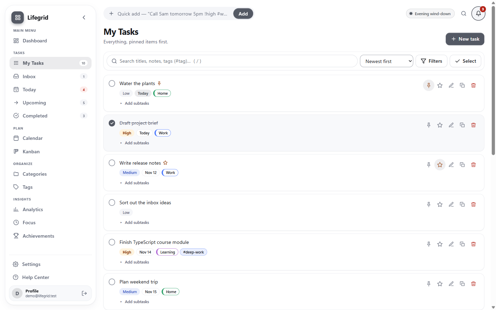
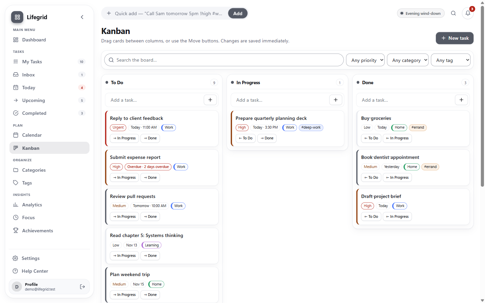
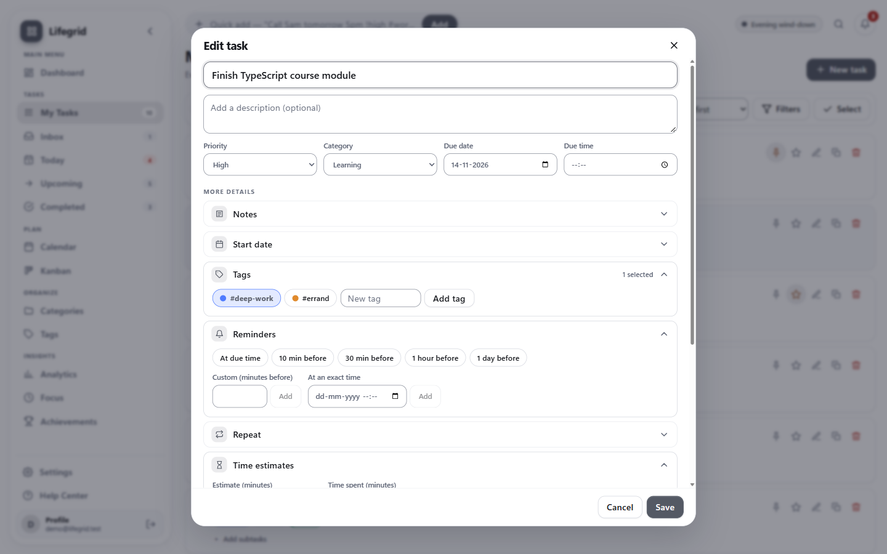
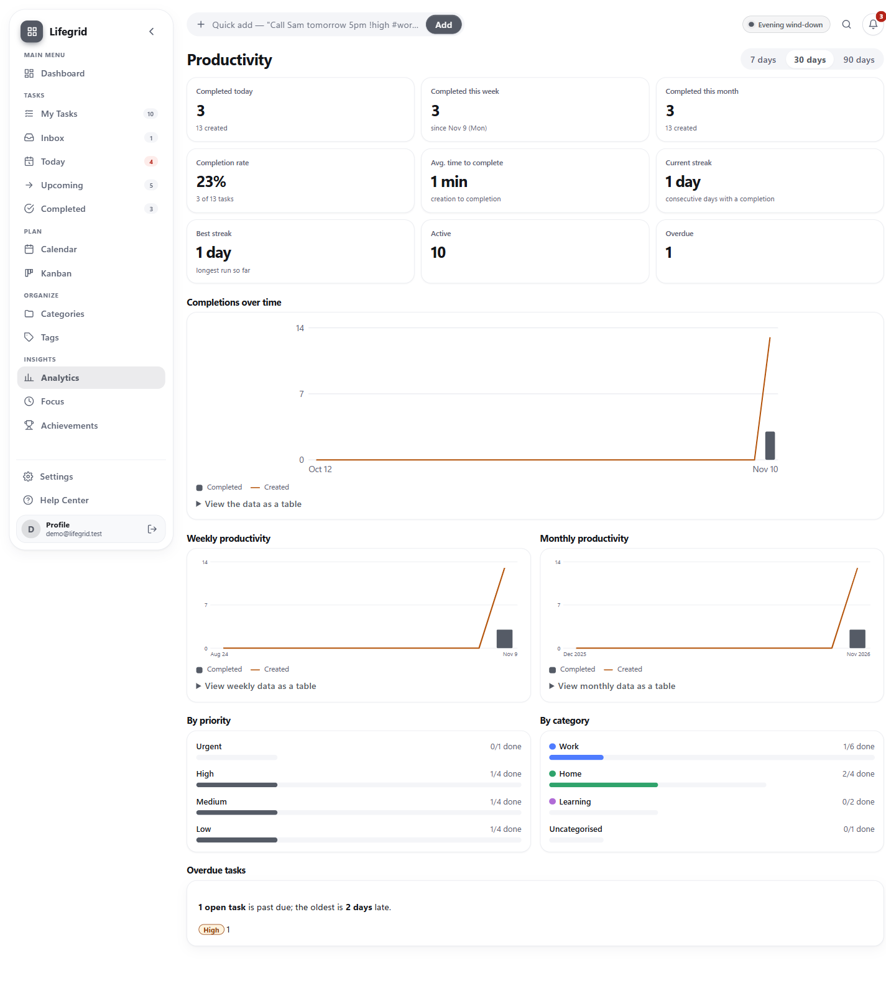
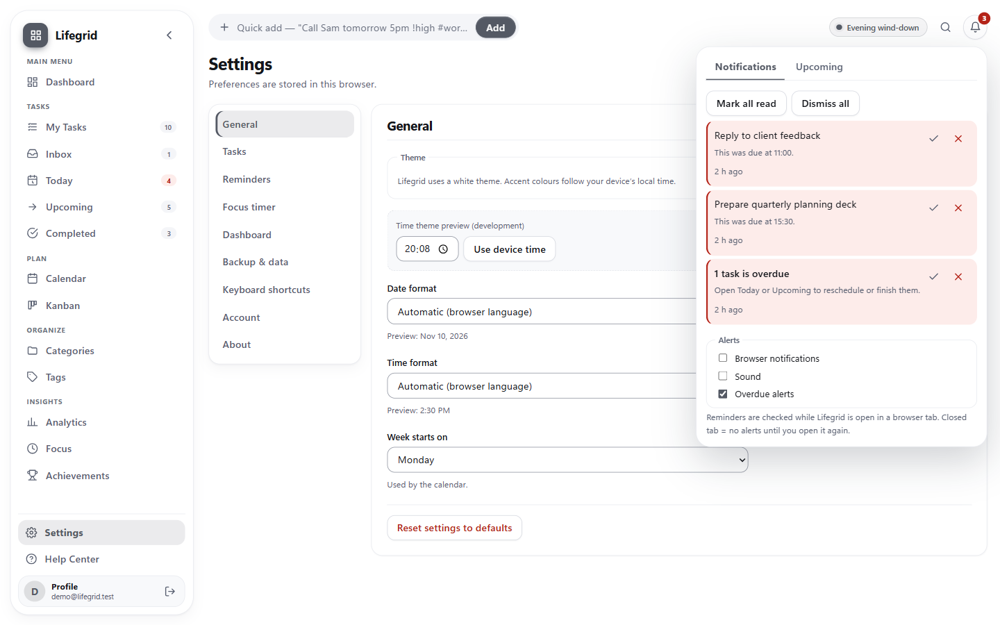
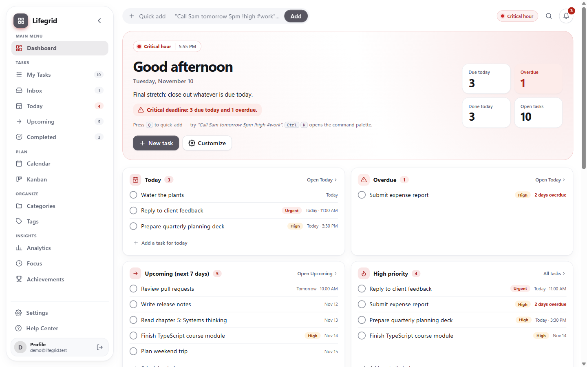
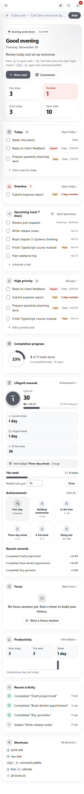

# Lifegrid

[](https://github.com/Chaithanya-07/Lifegrid/actions/workflows/ci.yml)

**Plan your day. Manage your tasks. Build better habits.**

Lifegrid is a personal productivity application: tasks, calendar, Kanban, a focus timer, and
server-authoritative rewards in one calm, keyboard-friendly workspace. It runs locally or on your
own server — your tasks live in a single SQLite file that you own, not in somebody's cloud. It
evolves the existing TaskFlow codebase rather than replacing it, keeping its React/TypeScript
frontend, ASP.NET Core API, and established task workflows.

## Key features

- **Task management** — My Tasks, Inbox, Today, Upcoming and Completed lists with priorities,
  categories, tags, subtasks, pinned items, filters and instant search.
- **Calendar and Kanban** — a month/week calendar and a drag-and-drop board whose moves save
  immediately.
- **Reminders and recurring tasks** — reminder alerts while the app is open, an overdue digest, and
  calendar-aware recurrence series that never skip or duplicate occurrences.
- **Focus timer and analytics** — task-linked focus sessions, completion trends, weekly and monthly
  productivity charts.
- **Rewards** — XP for completing tasks, levels, daily streaks, achievement badges, and an editable
  weekly goal, all awarded transactionally and recorded in an auditable ledger.
- **Time-based accent theme** — accented colours follow your device's clock over white surfaces and
  update live; contrast is tested against WCAG AA at every hour of the schedule.
- **Backup, import and export** — JSON and CSV export, validated import, automatic backups, and a
  transactional restore with a safety snapshot first.
- **Accessibility** — a clean axe-core WCAG 2.1 A/AA audit of 13 page and dialog states and a
  regression-tested keyboard story: focus traps, focus restoration, and Escape closing the topmost
  overlay only.
- **Responsive interface** — one codebase from a 390-pixel phone (drawer navigation) to a wide
  desktop (collapsible sidebar).

## Screenshots

Captured from the running application with demo data only.

**Dashboard**

<p align="center">
  
</p>

**Task lists, board and editor**

<p align="center">
  
  
</p>

<p align="center">
  
  
</p>

**Analytics and notifications**

<p align="center">
  
</p>

<p align="center">
  
</p>

**Time-based interface**

<p align="center">
  
  
</p>

**Responsive design**

<p align="center">
  
</p>

## Technology

| Layer | Tools |
|---|---|
| Frontend | React 19, TypeScript, Vite, CSS (no runtime UI library) |
| Backend | ASP.NET Core Web API on .NET 10, Entity Framework Core, SQLite |
| Testing | Vitest + Testing Library (unit), xUnit (API), Playwright (end to end) |
| CI | GitHub Actions on Windows runners (lint, unit, API, e2e — see the badge above) |

The `TaskFlow.*` project and namespace names, storage keys, database filename, backup naming and
`taskflow-export` schema are retained where compatibility matters (existing databases, exports and
sessions stay readable); the product surface is Lifegrid. The full identifier list is in
[docs/ARCHITECTURE.md](docs/ARCHITECTURE.md#taskflow-compatibility-identifiers).

## Architecture

`Controllers → Services → Data access (EF Core) → SQLite`, with a React 19 single-page frontend
that talks to `/api` under cookie-based sessions; every record is filtered by the authenticated user
in the data layer.

```
Browser (React, Vite)  ──/api──▶  ASP.NET Core API (:5062)  ──EF Core──▶  SQLite (data/taskflow.db)
  localStorage: settings, timer                     │
                                                    ├─ attachments  data/attachments/
                                                    └─ backups      data/backups/
```

Design decisions in brief: no repository layer over `IQueryable` (the `DbContext` is the unit of
work), all business rules in services, errors as RFC 7807 `ProblemDetails`, serializable
transactions for multi-step writes against SQLite's single-writer model, additive EF Core
migrations applied at startup, database-side aggregations for analytics and rewards, and an
auditable XP ledger protected by uniqueness constraints. The details live in
[docs/ARCHITECTURE.md](docs/ARCHITECTURE.md).

## Project structure

```
Lifegrid/
├─ api/
│  ├─ TaskFlow.Api/        ASP.NET Core Web API — Controllers → Services → EF Core (SQLite)
│  └─ TaskFlow.Tests/      xUnit suite: WebApplicationFactory against throwaway SQLite files
├─ web/
│  ├─ src/                 React 19 + Vite: pages/, components/, focus/, hash routing
│  └─ e2e/                 Playwright suite driving the real app on isolated ports 5292/5293
├─ docs/                   Architecture, accessibility audit, e2e guide, security, deployment docs
├─ docs/screenshots/       The images above
├─ .github/workflows/ci.yml  Frontend / backend / e2e jobs per push and pull request
├─ Dockerfile              Production image (persistent /data volume)
├─ docker-entrypoint.sh    Ownership fix, $PORT binding, privilege drop
└─ railway.json            Railway deploy template (health check /health, single replica)
```

## Getting started

Prerequisites: .NET 10 SDK, Node.js 22 (or later), and npm.

1. Start the API:

   ```powershell
   cd api/TaskFlow.Api
   dotnet restore
   dotnet run --launch-profile http
   ```

   The API listens at `http://localhost:5062` and applies pending EF Core migrations at startup.

2. In a second terminal, start the frontend:

   ```powershell
   cd web
   npm install
   npm run dev
   ```

   Open `http://localhost:5174` and register an account — everything stays on your machine.

## Environment configuration

Local development needs no environment configuration: `appsettings.Development.json` uses relative
paths anchored at the repository, so the database (`data/taskflow.db`), backups and attachments
resolve inside the repository's `data/` directory regardless of the terminal's working directory,
and the resolved locations are logged at API startup. Set `LIFEGRID_DATA_DIRECTORY` to relocate the
whole development data directory; absolute paths in configuration are always respected.

Deployment-style configuration (the API reads variables with `__` as section nesting) is documented
with placeholders in [.env.example](.env.example): the SQLite connection string, the backups,
attachments and Data Protection key directories, `AllowedHosts`, `Cors__Origins__0`, `TZ` for the
"local day" used by analytics and streaks, plus optional sign-up and rate-limit controls.
[docs/RAILWAY_DEPLOYMENT.md](docs/RAILWAY_DEPLOYMENT.md) walks through the container deployment
template.

## Testing

```powershell
cd web
npm test            # frontend unit suite (Vitest + Testing Library)
npm run lint        # Oxlint
npm run build       # production build (tsc + vite)
npm run test:e2e    # Playwright end-to-end suite
cd ../api
dotnet test TaskFlow.Tests/TaskFlow.Tests.csproj
```

Latest verification (2026-11-12): frontend unit suite **335/335**, backend suite **366/366**, and
the Playwright suite **39/39** — registration and session handling, session expiry, task journeys,
XP awarded exactly once, import/export and backup/restore, multi-account isolation, reminder and
Kanban/Calendar journeys, a 13-state axe-core WCAG 2.1 A/AA audit, and the keyboard/screen-reader
suite including the mobile-drawer focus trap. The end-to-end suite boots its own API and frontend
on ports 5292/5293 against a throwaway SQLite database under `web/test-results/e2e-data` and never
touches development data (see [docs/E2E_TESTING.md](docs/E2E_TESTING.md)).

## Security and data safety

- Per-user data isolation in the API's data layer, signed and encrypted cookie sessions, upload and
  import hardening, and rate limiting that identifies real clients behind trusted private-network
  proxies (see [docs/PRODUCTION_SECURITY.md](docs/PRODUCTION_SECURITY.md) for the trust model and
  deployment assumptions).
- No secrets exist in the configuration; the only generated secret material is the Data Protection
  key ring. [.env.example](.env.example) lists the configuration surface with placeholders only.
- New features use additive EF Core migrations; imports are validated before writing, restores are
  transactional and preceded by a safety snapshot, and back up the database before applying
  migrations in production.
- Tests never touch development data: unit and API tests use temporary SQLite files and the browser
  suite uses its own throwaway instance.

## Documentation

- [Architecture](docs/ARCHITECTURE.md)
- [Database schema](docs/DATABASE_SCHEMA.md)
- [API reference](docs/API_REFERENCE.md)
- [User guide](docs/USER_GUIDE.md)
- [End-to-end testing](docs/E2E_TESTING.md)
- [Accessibility audit](docs/ACCESSIBILITY_AUDIT.md)
- [Production security](docs/PRODUCTION_SECURITY.md)
- [Deployment (Railway template)](docs/RAILWAY_DEPLOYMENT.md)
- [Deployment status](docs/DEPLOYMENT_PROGRESS.md)
- [GitHub publishing record](docs/GITHUB_PUBLISHING.md)
- [Implementation progress](docs/IMPLEMENTATION_PROGRESS.md)
- [Completion audit](docs/COMPLETION_AUDIT.md)
- [Roadmap](ROADMAP.md)

## License

[MIT](LICENSE) © Kurra Chaithanya
