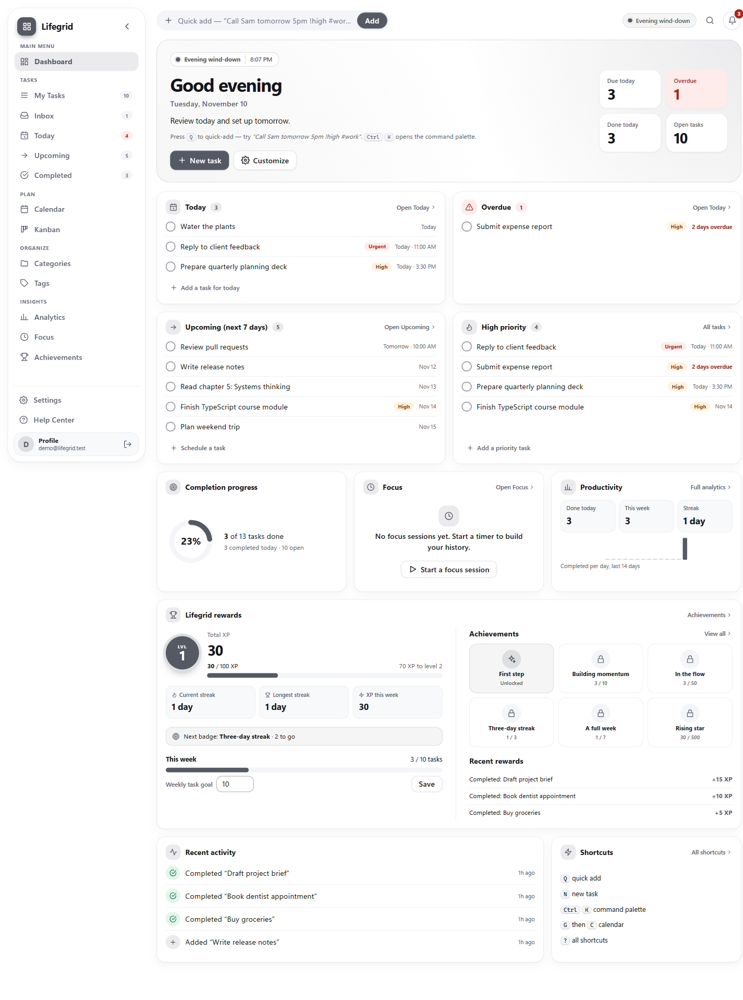
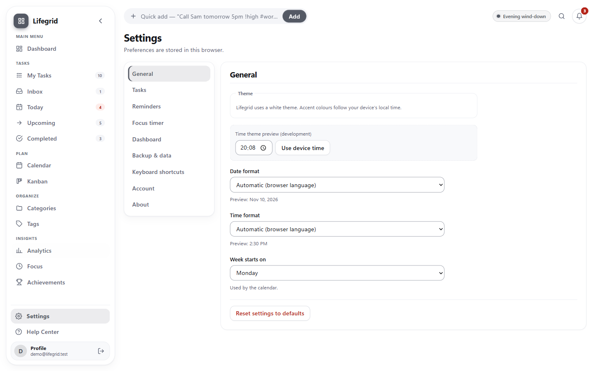
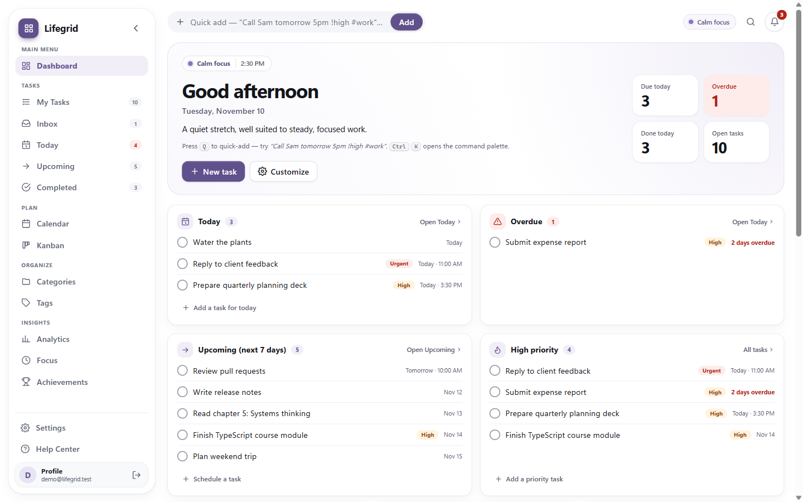

# Lifegrid

Lifegrid is a personal productivity application for organizing tasks, planning time, and building consistent habits. It evolves the existing TaskFlow application rather than replacing it, retaining its React/TypeScript frontend, ASP.NET Core API, SQLite database, authentication, and established task workflows.

## Features

- Task lists for My Tasks, Inbox, Today, Upcoming, and Completed
- Task priorities, categories, tags, subtasks, reminders, recurring tasks, attachments, and activity history
- Calendar and Kanban views with persisted task status and ordering
- Dashboard, productivity analytics, and task-linked focus sessions
- Account authentication and per-user data isolation
- JSON and CSV export, validated import, automatic backups, and transactional restore
- White-only interface with a local-device-time accent theme
- Server-authoritative XP, levels, daily streaks, achievement badges, weekly goals, and reward history
- Dedicated Achievements screen and a Help Center that documents the reward rules
- Playwright end-to-end tests against an isolated throwaway instance (`npm run test:e2e`), including an automated axe-core WCAG 2.1 A/AA audit of the main pages and dialogs
- Forwarded-header trust tied to private/loopback proxy networks so rate limiting identifies real clients behind Railway/Vercel

## Screenshots

Captured from the running application against a throwaway demo database, at the real local time (evening, neutral accent) unless noted.

| Dashboard | Task editor |
|---|---|
|  |  |

| My Tasks | Kanban |
|---|---|
|  |  |

| Analytics | Settings |
|---|---|
|  |  |

Time-based accents, produced with the development-only time simulator:

| 2:30 PM, "Calm focus" | 5:55 PM, "Critical hour" with a deadline alert |
|---|---|
|  |  |

Mobile dashboard (390 px wide): 

## Interface

- **Navigation:** a floating, rounded sidebar grouped as Main menu, Tasks, Plan, Organize and Insights (Dashboard; My Tasks, Inbox, Today, Upcoming, Completed; Calendar, Kanban; Categories, Tags; Analytics, Focus, Achievements). Settings, Help Center, Profile and Sign out sit at the bottom. It collapses to icons on desktop and becomes a drawer on small screens.
- **Dashboard:** a hero with greeting, date, live time, the current time-period label and message, and a real-deadline alert; then Today, Overdue, Upcoming, High priority, Completion progress, Lifegrid rewards, Focus, Productivity, Recent activity and Shortcuts. Every widget is an independent child of one responsive grid, and each empty state offers a next step.
- **Task editor:** title, description, priority, category, due date and due time are always visible. Notes, start date, tags, reminders, repeat, time estimates, status/pin/favorite, subtasks, files and history are collapsible sections with a summary of what is set. Subtasks and files need a saved task and say so on new tasks.
- **Design system:** shared tokens in `web/src/index.css` (surfaces, text, borders, radii, shadows, control height, semantic colours). Only the `--accent*` tokens change with the clock; danger, warning and success colours are fixed so they stay distinct.
- **Accessibility:** accent ink is capped to a luminance that gives at least 4.5:1 against white and against its own pastel tint at every minute of the schedule (asserted in tests); animation respects `prefers-reduced-motion`.

## Time-based accents

The page and card surfaces remain white and text remains dark. Accent colors follow the browser's local time and update without a page refresh:

| Local time | Accent |
|---|---|
| 9:00 AM–12:00 PM | Green to peach-yellow |
| 12:00 PM–1:00 PM | Neutral |
| 1:00 PM–2:00 PM | Happy yellow |
| 2:00 PM–3:00 PM | Calm lavender-blue |
| 3:00 PM–4:00 PM | Orange transition |
| 4:00 PM–5:50 PM | Orange to warning red |
| 5:50 PM–7:00 PM | Critical red, overriding the afternoon state |
| 7:00 PM onward | Neutral |

A development-only simulator is available in Settings to exercise the schedule. It is not available in production.

The dashboard and top bar also show a period label and message for the same boundaries (for example "Morning momentum", "Calm focus", "Deadline window", "Critical hour"). A deadline alert appears in the Deadline window and Critical hour only when tasks are actually due today or overdue.

## Rewards

The API awards task-completion XP once per task: Low = 5, Medium = 10, High = 15, and Urgent = 15. Completing every task due on the current local day grants one additional 20 XP daily bonus. Reward creation is transactional and protected by database uniqueness constraints. Levels advance every 100 XP; the default weekly goal is 10 completed tasks and can be set from 1 to 100. Achievements, streaks, and reward history are derived from persisted completion and reward records.

## Technology

- **Frontend:** React 19, TypeScript, Vite, CSS, Vitest, Testing Library, and Oxlint
- **Backend:** ASP.NET Core Web API on .NET 10, Entity Framework Core, and SQLite
- **Authentication:** Existing signed and encrypted cookie sessions; cookies and Data Protection identifiers are intentionally preserved
- **Routing/state:** Existing hash-based routes and React context providers
- **License:** MIT ([LICENSE](LICENSE)); © by the Lifegrid contributors
- **CI:** GitHub Actions (`.github/workflows/ci.yml`) runs the frontend lint/unit/build, the backend restore/build/test, and the Playwright e2e suite (against the isolated throwaway instance) on pushes to `main` and on pull requests; reports and failure artifacts are uploaded. Status badge to add when the repository is public.

The `TaskFlow.*` project and namespace names, storage keys, database filename, backup naming, and `taskflow-export` JSON schema are retained where they are compatibility-sensitive. User-facing product branding is Lifegrid.

## Run locally

Prerequisites: .NET 10 SDK, Node.js, and npm.

1. Start the API:

   ```powershell
   cd api\TaskFlow.Api
   dotnet restore
   dotnet run --launch-profile http
   ```

   The API listens at `http://localhost:5062`. Pending EF Core migrations are applied at startup.

2. In another terminal, start the frontend:

   ```powershell
   cd web
   npm install
   npm run dev
   ```

   Open `http://localhost:5174`. The Vite development server proxies `/api` requests to the local API. Register an account to begin.

Data lives under the repository `data\` directory: `data\taskflow.db` (plus its `-wal`/`-shm` companions), `data\backups`, `data\attachments`, and `data\run`. In development these locations are configured as absolute paths in `api/TaskFlow.Api/appsettings.Development.json`; the app finds them regardless of its working directory (`dotnet run` launches the app with the project folder as its CWD, so relative paths would resolve into `api/TaskFlow.Api/` instead — that is why the development override is absolute). The production connection in `appsettings.json` keeps its own relative paths. Production deployments must use persistent storage and configure a persistent Data Protection key directory; changing those locations can make existing data or sessions appear unavailable.

## Validation

Run commands from the repository root unless noted:

```powershell
cd web
npm test
npm run lint
npm run build
npm run test:e2e
cd ..\api
dotnet test TaskFlow.Tests\TaskFlow.Tests.csproj
```

The end-to-end suite (Playwright) boots its own API and frontend on ports 5292/5293 with a throwaway
SQLite database under `web/test-results/e2e-data` — it never touches the development or real data
folders. See [docs/E2E_TESTING.md](docs/E2E_TESTING.md).

The API integration tests use temporary SQLite databases. Do not point tests or migration tooling at a production database.

## Data safety and compatibility

- New persistent features use additive EF Core migrations; the existing database and migration history remain in place.
- Back up production data before deploying a schema change. Verify the backup and restore path before relying on it.
- Imports are validated before writing and remain additive. Restore replaces the signed-in user's data transactionally and takes a safety snapshot first.
- New JSON export fields are optional so existing export files remain readable. The `taskflow-export` schema identifier is unchanged.
- User-owned records are scoped by the authenticated user in the API's data layer.
- Expected unique-index races (concurrent notification-sync and weekly-goal writers) are handled explicitly and proven by `api/TaskFlow.Tests/ConcurrencyTests.cs`; no database row is ever duplicated or lost by two concurrent tabs.

## Security considerations

- Per-user data isolation, session handling, upload/import hardening, and the forwarded-header trust model (private/loopback proxies only, so rate limiting identifies real clients) are documented in [docs/PRODUCTION_SECURITY.md](docs/PRODUCTION_SECURITY.md), with the deployment assumptions called out there.
- No secrets exist in the configuration; the only secret material is the auto-generated Data Protection key ring. See [.env.example](.env.example) for the configuration surface.
- The e2e and CI suites run only against throwaway SQLite instances and never touch the development or real database.

## Project documentation

- [Architecture](docs/ARCHITECTURE.md)
- [Database schema](docs/DATABASE_SCHEMA.md)
- [API reference](docs/API_REFERENCE.md)
- [User guide](docs/USER_GUIDE.md)
- [End-to-end testing](docs/E2E_TESTING.md)
- [Accessibility audit](docs/ACCESSIBILITY_AUDIT.md)
- [Production security](docs/PRODUCTION_SECURITY.md)
- [Deployment](docs/RAILWAY_DEPLOYMENT.md)
- [Implementation progress](docs/IMPLEMENTATION_PROGRESS.md)
- [Roadmap](ROADMAP.md)
